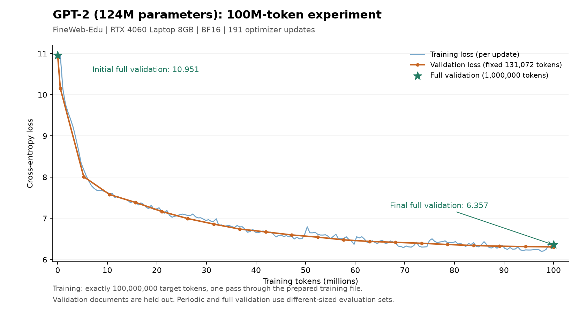

# GPT-2：1 亿 token 单卡实验

实验日期：2026-11-10。训练已实际完成，程序正常退出；数据、日志、最终 checkpoint 的计数已交叉核验。

## 代码检查与修复

原来的模型主体、GPT 风格初始化、AdamW、梯度裁剪和学习率调度已经具备，但还不是完整的预训练流程。训练循环还有两个问题：梯度累积之前多取并丢弃了一个 batch；累积之后又对最后一个 microbatch 做了一次未缩放的反向传播，使该批次权重过大。

保留现有 GPT 模型及优化器实现，修正上述训练循环，补齐 FineWeb-Edu 数据准备、独立验证、checkpoint、断点续训和训练后的文本生成。最后不足一个完整 batch 的数据按实际目标 token 数加权，没有为了凑整而重复训练数据。

## 本次设置

| 项目 | 设置 |
| --- | --- |
| 模型 | GPT-2，12 层、12 头、768 维，124,475,904 参数 |
| 上下文长度 | 1024 |
| GPU | NVIDIA GeForce RTX 4060 Laptop GPU，8GB |
| PyTorch | 2.6.0+cu124 |
| 计算方式 | BF16 autocast、torch.compile、PyTorch SDPA |
| Microbatch | 4 × 1024 = 4096 token |
| 有效 batch | 524,288 token，通常累积 128 次 |
| 训练预算 | 100,000,000 个目标 token，一遍读取准备好的训练文件 |
| 参数更新 | 191 次；最后一次 385,280 token |
| 优化器 | AdamW，betas=(0.9, 0.95)，eps=1e-8，weight decay=0.1 |
| 学习率 | 10 次更新 warmup，6e-4 余弦衰减到 6e-5 |
| 梯度裁剪 | 1.0 |
| 验证 | 每 10 次更新使用固定 131,072 token；最终评估全部 1,000,000 token |
| 初始化随机种子 | 1337 |
| 采样 | 固定提示词，200 个新 token，temperature=0.8，top-k=50，seed=42 |

数据来自 [HuggingFaceFW/FineWeb-Edu](https://huggingface.co/datasets/HuggingFaceFW/fineweb-edu) 的 sample-10BT，使用该子集第一个 parquet 的前一部分。来源和 ODC-By 许可记录在 `../edu_fineweb100M/manifest.json` 中。验证数据先取，训练从下一篇文档开始；跨越验证截断点的剩余文档内容被丢弃。训练和验证按文档边界分开，没有将验证文档的后半段放进训练集。该实验使用一个数据前缀，并非对完整语料的全局随机抽样。

## 实际结果

| 指标 | 结果 |
| --- | ---: |
| 初始完整验证 loss | 10.951498 |
| 最终完整验证 loss | 6.357129 |
| 初始完整验证 perplexity | 57,039.43 |
| 最终完整验证 perplexity | 576.59 |
| 最佳定期验证 loss | 6.305204 |
| 训练更新累计耗时 | 4466.49 秒，约 74.44 分钟 |
| 稳定阶段吞吐中位数 | 22,664 token/s |

初始和最终“完整验证”使用相同的全部 100 万目标 token，可直接比较。定期验证只使用其中固定的 131,072 token，因此它与完整验证的 loss 数值有差别。耗时是训练更新计时的累加，包含更新内发生的编译，不包含数据准备、验证和保存 checkpoint 等其他开销。



验证 loss 显著下降，但 `sample.txt` 中的生成文本仍有语法和连贯性问题。本次只使用课程 100 亿 token 预算的 1%，模型仍处于早期训练；本实验验证的是单卡预训练闭环，不能作为已达到原版 GPT-2 文本质量的证据。未进行多卡 DDP 或 HellaSwag 下游评测。

## 核验与文件

已确认日志恰有 191 条连续的更新记录，最终训练计数和数据游标均为 100,000,000；AdamW 中各参数的更新计数均为 191；模型参数有限、权重共享保留、checkpoint 能严格加载、训练和验证文件校验和未改变。用相同种子重建未训练模型，定期验证初始 loss 与原记录完全一致。

- `summary.json`：完整指标、验证历史和核验结果。
- `train.jsonl`：每次参数更新的训练 loss、学习率、梯度范数与耗时。
- `last.pt`：模型、优化器、数据位置和随机数状态，用于续训。
- `best.pt`：定期验证最优时的模型权重与配置。
- `sample.txt`：最终权重生成的文本，UTF-8 编码。
- `config.json`：实验配置和数据来源。

如果同一次实验运行中断，可执行：

```powershell
& 'D:\conda_envs\llm\python.exe' 'D:\llm-from-scratch\05_GPT-2\gpt_train.py' --resume
```

本次预算已经完成，无需再次启动。对已完成的 checkpoint 执行上述命令会重新评估和生成文本，不会继续增加训练 token。
